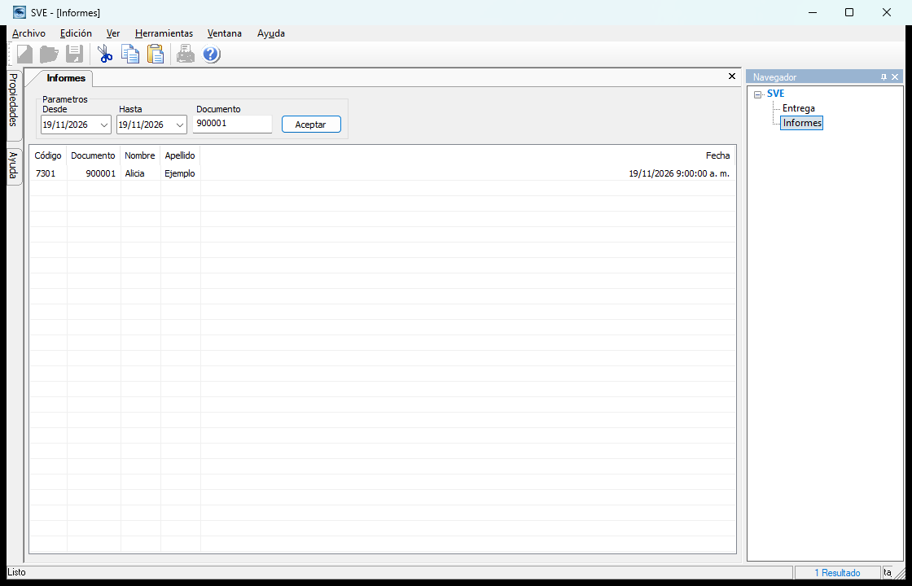
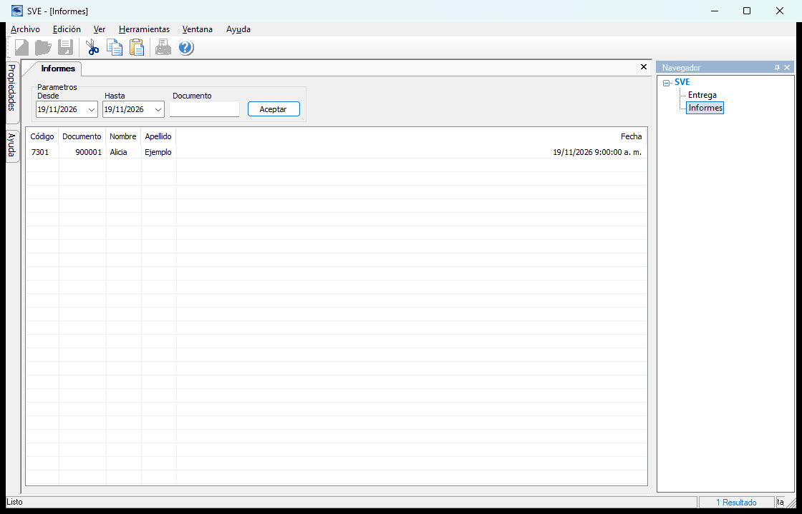

# SVE
[English](#english) · [Español](#español)

## English


Legacy Windows app to verify shipments at handover and filter reports by date and ID

> [!WARNING]
> **Status: Legacy.** Archive for local evaluation.

### Overview

SVE was built for a staffed handover desk. An operator signs in, opens the delivery form, locates a person by document number and can associate evidence with a delivery. The report view lists recorded handovers for a date range and can filter by document.

### Features

- **Entrega** looks up a recipient by document and records the tracking reference, package, weight and office. It offers photo and fingerprint capture.
- **Informes** shows delivery code, document number, name, surname and date. The view has export and print-preview commands.
- The administration module defines users, permissions and groups separately from the delivery views.

### Requirements

The exact archived third-party files are included. Their notices and hashes are in THIRD-PARTY-NOTICES.md. The archived GrFinger SDK is included under vendor/grfinger-sdk/.

Tested on Windows 11 Pro build 26300, Visual Studio Community 18.11.4, MSVC and MFC v145 14.51.36263, Windows SDK 10.0.26100.0 and MSBuild 18.11.1.51303. The Win32 build uses the included MySQL 5.0.16 and GrFinger 4.2.0 x86 SDKs and archived WIA samples. The local report demo uses PowerShell 7.6.9, Docker Engine 29.9.2, Compose 5.6.1 and MySQL 5.7.44. Physical capture needs a compatible fingerprint reader and a camera or WIA scanner. The [archived GrFinger evaluation agreement](vendor/grfinger-sdk/GrFingerLicenseAgreement.txt) describes the manufacturer’s terms. Obtain a valid Griaule Biometrics license for device operations.

### Getting started

Run these steps from the repository root in Developer PowerShell. The Win32 SDK directories and runtime DLLs are included. The v145 solution builds the application and libraries, and the last command copies the three runtime DLLs beside the executable.

```powershell
$mysql = (Resolve-Path ./vendor/mysql-sdk).Path
$grfinger = (Resolve-Path ./vendor/grfinger-sdk).Path
msbuild SVE.sln /t:Build /nologo /m:3 /nr:false /p:Configuration=Release /p:Platform=Win32 /p:PreferredToolArchitecture=x64 "/p:MySqlSdkDir=$mysql" "/p:GrFingerSdkDir=$grfinger"
Copy-Item "$mysql/libmysql.dll", "$grfinger/GrFinger.dll", "$grfinger/pthreadVC2.dll" bin/Release/
```

### Usage

Use a clean Windows test account. The launcher temporarily uses `HKCU\Software\SDG\SVE` and removes the profile it creates. Start MySQL and the desktop launcher, then sign in as `consulta_demo` with fictional password `DEMO_LOCAL_USER`. Open **Navegador → Informes**, enter `900001` in **Documento**, and press **Aceptar**. The current-day sample is delivery `7301`, Alicia Ejemplo. Close the desktop before stopping the container.

```powershell
docker compose -f demo/compose.yaml up -d --wait
pwsh -NoProfile -File demo/ProbarEscritorio.ps1
docker compose -f demo/compose.yaml down --volumes
```

### Project structure

`errorreport/ExceptionAttacher.cpp` and `ExceptionHandler.cpp` provide diagnostic exception handling. The application project `SVE/SVE.vcxproj` compiles both.

`SVE/SVE.cpp` starts the desktop and `SVE/InformesView.cpp` provides reports. `Administrador/` contains access administration and `appt/` holds app configuration. `vendor/` contains the libraries matched to the archived symbols. `compat/` supplies a Windows theme include and `demo/` contains MySQL definitions and fictional rows. `README.md` explains the setup and `.gitignore` ignores generated output and local support files. `external-sources.tsv` records original source hashes. `demo/strongbox-source-map.tsv` records comparisons against the related desktop project. `docs/media/` contains the report captures.

### Verification

With the Windows 11, MSBuild, MSVC and MFC versions in Requirements, `msbuild SVE.sln /t:Build /nologo /m:3 /nr:false /p:Configuration=Release /p:Platform=Win32 /p:PreferredToolArchitecture=x64 "/p:MySqlSdkDir=$mysql" "/p:GrFingerSdkDir=$grfinger"` exited 0. The recorded test launched a disposable MySQL container and started SVE.exe directly with the fictional fixture. Usage explains the separate Compose and PowerShell walkthrough. In the November 23, 2026 verification, the Win32 desktop signed in to an isolated MySQL 5.7.44 Docker service and retrieved one fictional delivery in **Informes**. The query is confirmed by the container log. Result: partial because no compatible fingerprint reader, camera or WIA scanner was available. Physical capture, fingerprint matching and scanning remain untested. The SDK runtime was loaded without requesting SVE’s own serial.

### Screenshots

The images come from a separate run of the same compiled sources and schema with one fictional delivery.





### History

The separate report captures were taken on November 19, 2026. The source date was recovered from the November 2008 project files and release symbols and recorded at noon UTC without the original timezone. The 2026 reconstruction adds the converted projects, Win32 dependency paths, disposable schema and new readme. SVE’s serial and trial checks are off unless the build defines `ENABLE_LICENSE_CHECK`.

### Support

Report the commit, Windows version, and a reproducible step using the fictional fixture in Issues.

### Contributing

Keep small changes focused on one desktop view or dependency and include a Win32 build result.

### License

Own sources use the [MIT License](LICENSE). See [third-party notices](THIRD-PARTY-NOTICES.md) for separate terms.

---

## Español


Legado — aplicación de Windows para verificar entregas y filtrar informes por fecha y documento

> [!WARNING]
> **Estado: Legado.** Respaldo para evaluación local.

### Descripción general

SVE se diseñó para un puesto de entrega atendido por un operador. El operador inicia sesión, abre el formulario, encuentra a la persona por número de documento y puede asociar evidencias con la entrega. El informe muestra entregas por rango de fechas y permite filtrar por documento.

### Funciones

- **Entrega** busca al destinatario por documento y registra guía, paquete, peso y oficina. Ofrece captura de fotos y huellas.
- **Informes** muestra código, documento, nombre, apellido y fecha. La vista tiene opciones de exportación y vista previa de impresión.
- El módulo de administración define usuarios, permisos y grupos por separado.

### Requisitos

Se incluyen las dependencias exactas del respaldo. Sus avisos y hashes figuran en THIRD-PARTY-NOTICES.md. El SDK GrFinger archivado se incluye en vendor/grfinger-sdk/.

Probado en Windows 11 Pro compilación 26300, Visual Studio Community 18.11.4, MSVC y MFC v145 14.51.36263, Windows SDK 10.0.26100.0 y MSBuild 18.11.1.51303. La compilación Win32 usa los SDK incluidos de MySQL 5.0.16 y GrFinger 4.2.0 x86 y los ejemplos WIA archivados. La prueba de informes usa PowerShell 7.6.9, Docker Engine 29.9.2, Compose 5.6.1 y MySQL 5.7.44. La captura física requiere un lector de huellas compatible y una cámara o un escáner WIA. El [acuerdo de evaluación archivado de GrFinger](vendor/grfinger-sdk/GrFingerLicenseAgreement.txt) describe las condiciones del fabricante. Consigue una licencia válida de Griaule Biometrics para operar el lector.

### Cómo empezar

Ejecuta estos pasos desde la raíz del repositorio en Developer PowerShell. Los SDK Win32 y las DLL de ejecución vienen incluidos. La solución v145 compila la aplicación y las bibliotecas. El último comando copia las tres DLL junto al ejecutable.

```powershell
$mysql = (Resolve-Path ./vendor/mysql-sdk).Path
$grfinger = (Resolve-Path ./vendor/grfinger-sdk).Path
msbuild SVE.sln /t:Build /nologo /m:3 /nr:false /p:Configuration=Release /p:Platform=Win32 /p:PreferredToolArchitecture=x64 "/p:MySqlSdkDir=$mysql" "/p:GrFingerSdkDir=$grfinger"
Copy-Item "$mysql/libmysql.dll", "$grfinger/GrFinger.dll", "$grfinger/pthreadVC2.dll" bin/Release/
```

### Uso

Usa una cuenta de Windows de prueba limpia. El lanzador usa temporalmente `HKCU\Software\SDG\SVE` y elimina el perfil que crea. Inicia MySQL y el lanzador, y entra con `consulta_demo` y la clave ficticia `DEMO_LOCAL_USER`. Abre **Navegador → Informes**, escribe `900001` en **Documento** y pulsa **Aceptar**. La muestra del día es la entrega `7301` de Alicia Ejemplo. Cierra la aplicación antes de detener el contenedor.

```powershell
docker compose -f demo/compose.yaml up -d --wait
pwsh -NoProfile -File demo/ProbarEscritorio.ps1
docker compose -f demo/compose.yaml down --volumes
```

### Estructura del proyecto

`errorreport/ExceptionAttacher.cpp` y `ExceptionHandler.cpp` gestionan el diagnóstico de excepciones. El proyecto de la aplicación `SVE/SVE.vcxproj` compila ambos archivos.

`SVE/SVE.cpp` inicia la aplicación y `SVE/InformesView.cpp` genera los informes. `Administrador/` contiene la administración de acceso y `appt/` la configuración. `vendor/` contiene las librerías cotejadas con los símbolos archivados. `compat/` adapta el encabezado de temas y `demo/` trae las tablas y filas ficticias. `README.md` explica el uso y `.gitignore` excluye salidas generadas y archivos auxiliares locales. `external-sources.tsv` registra los hashes originales. `demo/strongbox-source-map.tsv` registra el cotejo con el proyecto de escritorio relacionado. `docs/media/` contiene las capturas del informe.

### Verificación

Con las versiones de Windows 11, MSBuild, MSVC y MFC de Requisitos, `msbuild SVE.sln /t:Build /nologo /m:3 /nr:false /p:Configuration=Release /p:Platform=Win32 /p:PreferredToolArchitecture=x64 "/p:MySqlSdkDir=$mysql" "/p:GrFingerSdkDir=$grfinger"` terminó con código 0. La prueba registrada inició un contenedor MySQL desechable y abrió SVE.exe directamente con los datos ficticios. Uso explica el recorrido separado con Compose y PowerShell. En la verificación del 23 de noviembre de 2026, el escritorio Win32 inició sesión en MySQL 5.7.44 aislado en Docker y recuperó una entrega ficticia en **Informes**. El log del contenedor confirma la consulta. Resultado parcial por falta de lector de huellas, cámara y escáner WIA compatibles. Quedaron pendientes la captura física, la comparación de huellas y el escaneo. El SDK cargó sin pedir el serial propio de SVE.

### Capturas

Las imágenes se tomaron en una ejecución separada de las mismas fuentes compiladas y el mismo esquema con una entrega ficticia.


### Historial

Las imágenes del informe se tomaron en una prueba separada el 19 de noviembre de 2026. Se recuperó la fecha de los proyectos y símbolos de noviembre de 2008 y se registró al mediodía UTC porque el respaldo no indica zona horaria original. La reconstrucción de 2026 agrega proyectos convertidos, rutas Win32, esquema desechable y README. El serial y el periodo de prueba de SVE quedan desactivados salvo que se defina `ENABLE_LICENSE_CHECK`.

### Soporte

Reporta en Issues el commit, la versión de Windows y los pasos con datos ficticios.

### Contribuir

Limita los cambios a una vista o dependencia e incluye el resultado de compilación Win32.

### Licencia

Las fuentes propias usan la [licencia MIT](LICENSE). Consulta los [avisos de terceros](THIRD-PARTY-NOTICES.md) para otras condiciones.
